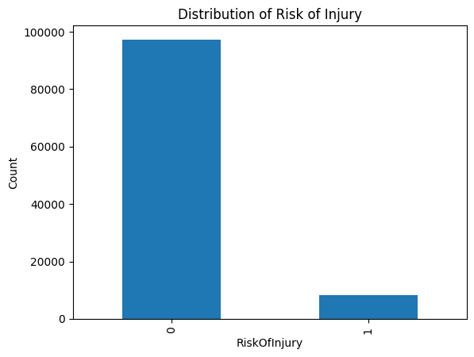
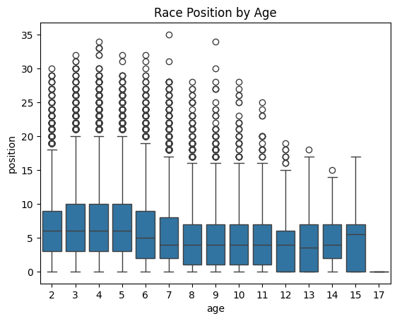
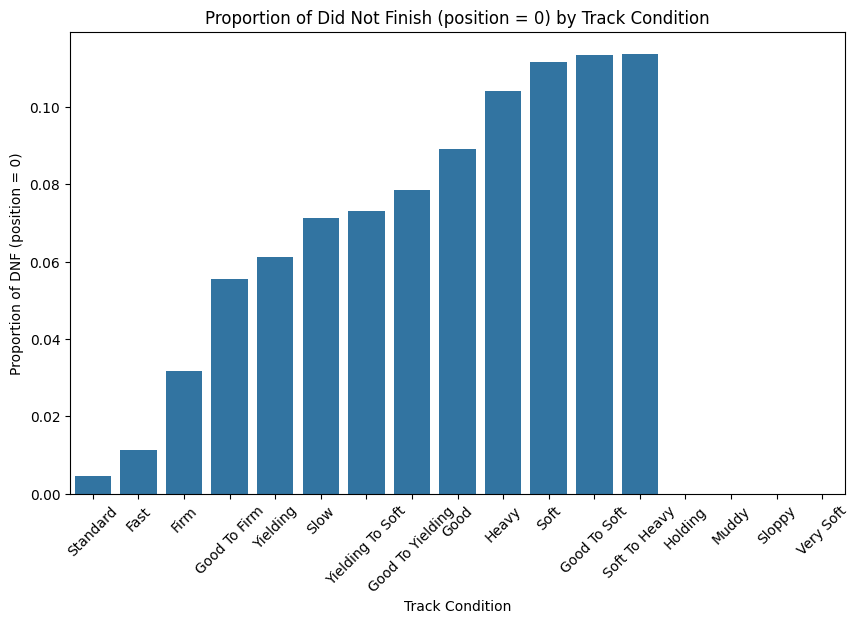
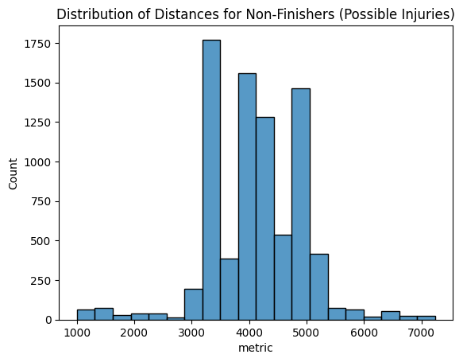
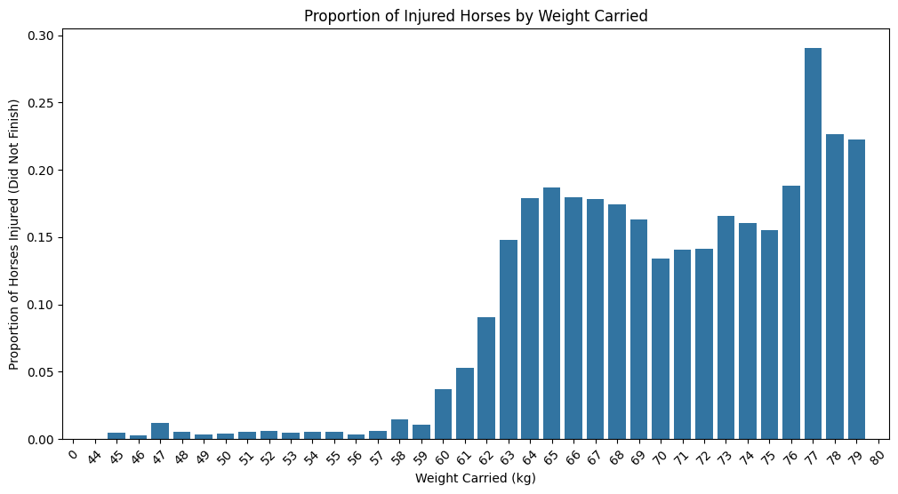
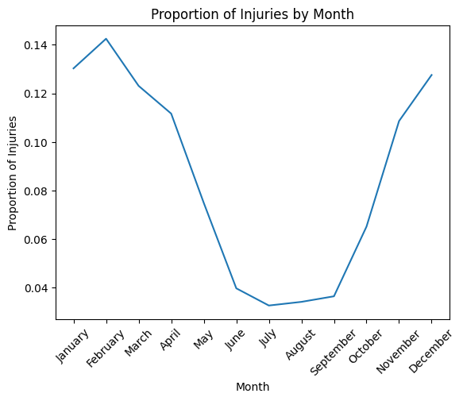
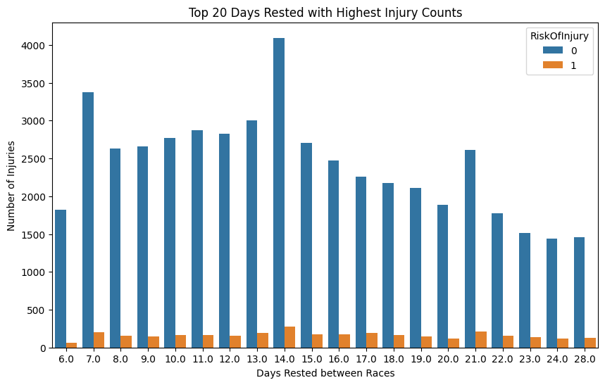
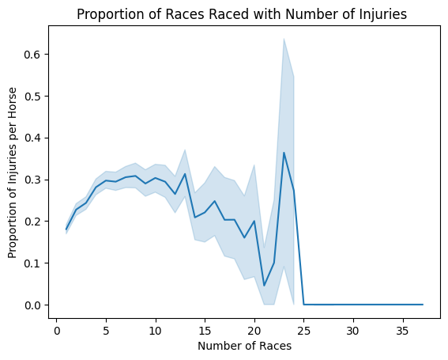

# UK Racehorse Non-Finishing Risk - BrainStation Capstone

This project started with a question about racehorse welfare: could historical race data help identify horses at risk of not finishing a race?

I used Python to clean and combine horse and race data, explore patterns, and compare classification models. Non-finishing is the model's target. I used it as an injury-risk proxy, but the dataset has no veterinary records, and a horse can fail to finish for reasons other than injury. This is not a validated injury predictor.

## Data

The source is the [Horse Racing dataset on Kaggle](https://www.kaggle.com/datasets/hwaitt/horse-racing). The project uses historical race and horse records, with variables including age, official rating, carried weight, race distance, track condition, days rested, and race count.

The source records a finishing position of `40` when a horse did not finish. In my cleaning notebook, I recoded that value to `0` and used `position == 0` to create the binary target called `RiskOfInjury` in the code. That variable name reflects my original project framing; it does not mean the data confirms an injury.

**Two data limits worth noting:**
- Weight is the handicap weight carried in the race, not the horse's body weight.
- Starting prices are not necessarily available before a race. Any future pre-race use would need a careful check of when each input becomes available.

## What I did

- Cleaned and merged race and horse records in Python.
- Explored class balance and patterns across race and horse variables.
- Compared logistic regression, random forest, and XGBoost models, including parameter search and threshold tuning.
- Used SMOTE to address class imbalance during modeling.
- Evaluated the selected model on a held-out test set.
- Built a Streamlit prototype to explore model predictions.

## Results and limitations

For the threshold-adjusted XGBoost model with SMOTE and parameter search, the held-out test results were:

| Metric | Value |
| --- | ---: |
| Recall on non-finishing cases | 0.93 |
| Precision on non-finishing flags | 0.18 |
| Accuracy | 0.67 |

The model caught most non-finishing cases in that test set, but only 18% of its flags matched the non-finishing label. Most flags were false alarms. The chosen threshold prioritizes catching non-finishing cases over avoiding false alarms.

These numbers describe the non-finishing proxy, not confirmed injuries. The evaluation used a random holdout rather than a time-based split, so it does not establish how well the model would predict future races. The project does not demonstrate injury prevention, medical usefulness, or betting returns.

## Exploratory analysis

The plots below come from the original project. Some titles and filenames still use the original injury-risk wording. In every case, the label means non-finishing, not a confirmed injury. These are descriptive patterns, not evidence of causes.

### Class balance

Non-finishing cases are the minority class, which made precision and recall important alongside accuracy.

### Age

I explored how the proxy varies across ages. Small groups and outliers need caution; this plot does not establish age-related injury risk.

### Track condition

I compared the proxy across recorded track conditions. Differences can reflect other race characteristics and do not show that a surface caused an injury.

### Distance

I explored non-finishing outcomes across race distances without treating the pattern as a causal relationship.

### Carried weight

This variable describes weight carried under the handicap system. It is not body weight, and this analysis does not establish a safe weight threshold.

### Seasonality

I explored monthly patterns. The data alone cannot establish weather-related injury causes.

### Rest intervals

I looked at the distribution of rest intervals, including the weekly scheduling patterns visible in the data.

### Race count

I explored race count alongside the proxy. This does not establish a fatigue threshold or a safe number of races.

## Repository guide

- `notebooks/`: cleaning, exploration, and modeling work.
- `data/`: project data resources.
- `models/`: saved model, including `xgboost_smote_gridsearch_model.pkl`.
- `docs/`: project figures and supporting materials.
- `references/`: supporting reading.
- `app.py`: Streamlit prototype.
- `capstone_env.yml`: environment specification.

## Running the prototype

The laptop-specific banner image path has been replaced with a repository-relative path. In a local smoke test, the Streamlit page loaded and a prediction completed without exceptions. The saved XGBoost model produced a version warning. This confirms a basic app run only, not model validity or portability across environments.

## What I would improve next

- Use a time-based evaluation to test on later races.
- Review every feature for pre-race availability and possible leakage.
- Investigate why horses did not finish rather than treating all non-finishing outcomes as injuries.
- Test the prototype in a clean environment and document the setup.

## Acknowledgments

Thank you to BrainStation, Stephen, Borna, and Miranda for their guidance during the 12-week program.
